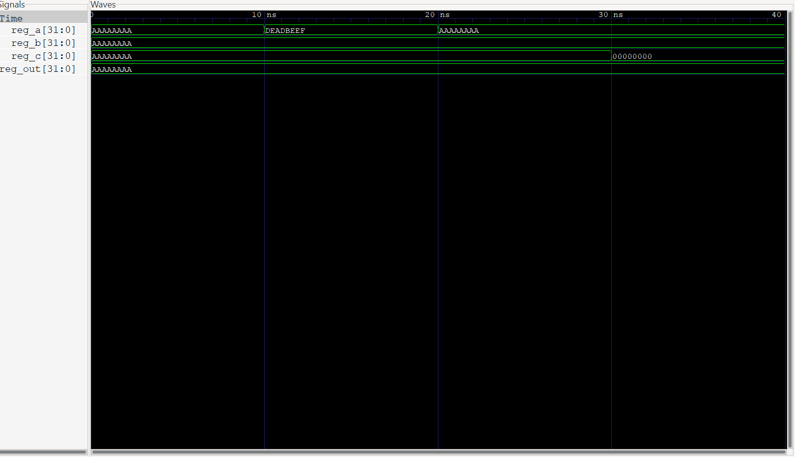
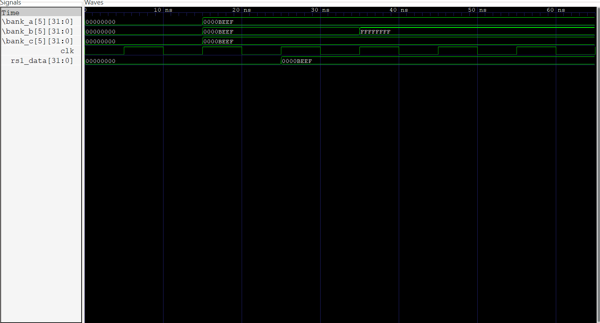
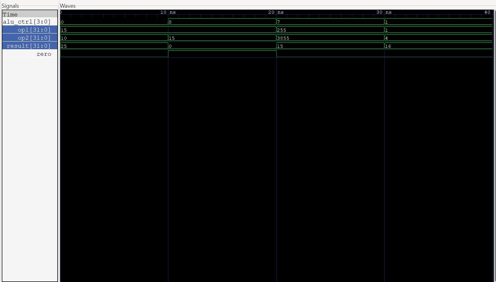
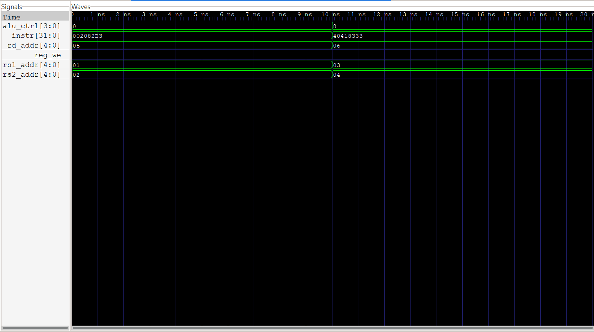
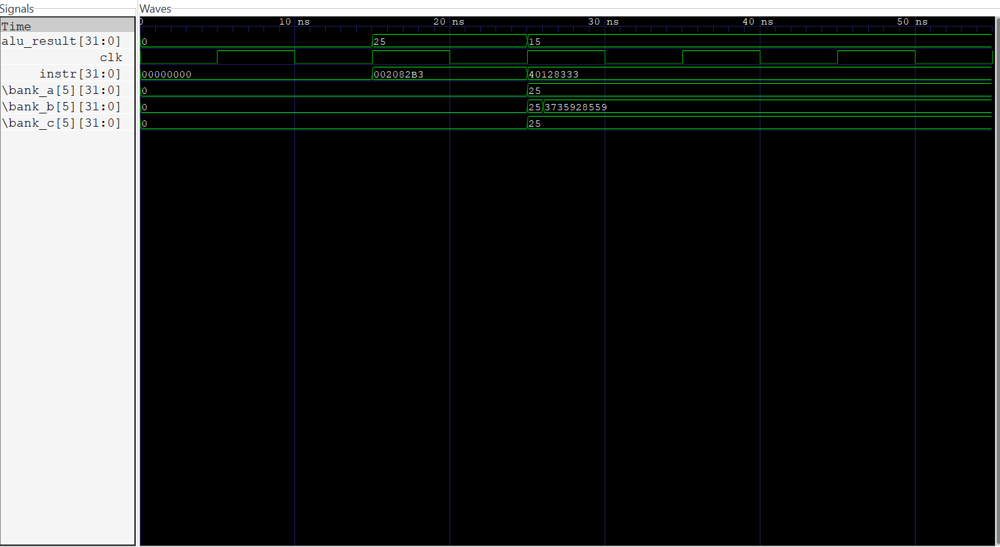

# Fault-Tolerant RISC-V Core: Radiation Hardening By Design (RHBD)

## Abstract
This repository contains a first-principles Verilog implementation of a fault-tolerant RISC-V (RV32I) execution core designed for high-radiation environments (e.g., aerospace, nuclear, and high-energy physics applications). The architecture employs Radiation Hardening By Design (RHBD) techniques, specifically focusing on Triple Modular Redundancy (TMR) to mitigate Single Event Upsets (SEUs) while optimizing for Power, Performance, and Area (PPA). 

Rather than applying TMR indiscriminately across the entire silicon area, redundancy is strictly isolated to the architectural state (the Register File). Combinational logic paths (ALU, Decoder) remain unprotected, as radiation-induced Single-Event Transients (SETs) in these regions dissipate dynamically before synchronous capture. This approach bridges abstract fault-tolerance theory with physical silicon efficiency.

---

## System Architecture


The datapath is structured around a single-cycle microarchitecture utilizing standard RV32I machine code decoding, a modular execution unit, and a redundant memory vault. Testing is conducted via simulated asynchronous high-energy particle strikes using hierarchical Verilog fault injection.

---

## Repository Structure

```text
riscv-tmr-fault-tolerance/
├── docs/                   # Waveform screenshots and architecture diagrams
├── src/                    # Synthesizable Verilog RTL
│   ├── core/               # Standard RISC-V execution modules (alu.v, decoder.v, cpu_core.v)
│   └── tmr/                # Radiation-hardened logic (tmr_voter.v, tmr_register_file.v)
├── tb/                     # Testbenches featuring hierarchical SEU fault injection
├── waves/                  # Generated .vcd simulation waveforms
└── README.md
```

---

## Phase 1: The Combinational Majority Voter
The foundation of the TMR architecture is the majority voting logic. Instead of a single register, data is stored across three independent banks. The voter continuously evaluates the outputs using the boolean logic `Y = (A&B) | (B&C) | (A&C)`.



**Verification:** The testbench initializes all registers to `AAAAAAAA`. An SEU is injected into `reg_a` (forcing `DEADBEEF`), followed by a separate strike on `reg_c` (forcing `00000000`). The combinational logic successfully masks both faults, maintaining a pristine `AAAAAAAA` output.

---

## Phase 2: The Radiation-Hardened Register File
The architectural state is protected by synthesizing three separate, identical 32-bit memory arrays (`bank_a`, `bank_b`, `bank_c`). Synchronous writes are broadcast to all three banks simultaneously. Asynchronous reads are routed continuously through the TMR voters.



**Verification:** A valid write of `0000BEEF` is committed to register `x5` at 15ns. At 35ns, a simulated particle strike violently corrupts `bank_b[5]` to `FFFFFFFF`. The waveform demonstrates the `rs1_data` output holding flawlessly at `0000BEEF`, validating the memory vault's resilience.

---

## Phase 3: The Execution Unit (ALU)
To preserve silicon area and power efficiency, the Arithmetic Logic Unit remains a standard, unprotected combinational block. Transient faults in the ALU dissipate before the next clock edge, rendering TMR overhead unnecessary here.



**Verification:** Functional verification of the execution unit. The ALU computes `15 - 15 = 0` at the 10ns mark, and the hardware `zero` flag correctly evaluates high instantly.

---

## Phase 4: Instruction Decoding
The Instruction Decoder serves as the hardware translator, mapping raw 32-bit compiled firmware into physical control lines (`alu_ctrl`, `reg_we`, `rs1_addr`, etc.) to orchestrate the datapath.



**Verification:** The module receives the RV32I machine code `0x002082B3` (ADD `x5, x1, x2`) and instantly routes the correct source registers (`1`, `2`) and operation code (`0`). At 10ns, it successfully transitions to `0x40418333` (SUB `x6, x3, x4`).

---

## Phase 5: Top-Level Integration & Datapath Resilience
The capstone of the architecture wires the Decoder, the TMR Register File, and the ALU into a complete execution loop. 



**Verification:** 
1. **15ns:** The CPU executes `ADD x5, x1, x2` (10 + 15), synchronously saving `25` across all three memory banks.
2. **25ns:** The CPU begins executing `SUB x6, x5, x1` (25 - 10).
3. **26ns:** A catastrophic asynchronous SEU strikes `bank_b[5]`, corrupting the stored `25` to `-559038737` (`DEADBEEF`) precisely when the ALU requires the operand.
4. **Result:** The datapath voters mask the memory failure dynamically. The ALU receives the clean `25` from the surviving banks and computes the final correct answer of `15`. 

---

## Toolchain & Reproduction
This core was developed and verified using a CLI-first open-source toolchain on WSL (Ubuntu).

**Dependencies:**
* `iverilog` (Icarus Verilog compiler)
* `gtkwave` (Waveform visualization)

**To reproduce the top-level simulation:**
```bash
# Clone the repository
git clone [https://github.com/FC-Pascal/riscv-tmr-fault-tolerance.git](https://github.com/FC-Pascal/riscv-tmr-fault-tolerance.git)
cd riscv-tmr-fault-tolerance

# Compile the top-level datapath
iverilog -o tb_cpu_core.vvp src/core/decoder.v src/tmr/tmr_voter.v src/tmr/tmr_register_file.v src/core/alu.v src/core/cpu_core.v tb/tb_cpu_core.v

# Execute the simulation
vvp tb_cpu_core.vvp

# Visualize the fault injection
gtkwave waves/cpu_core.vcd &